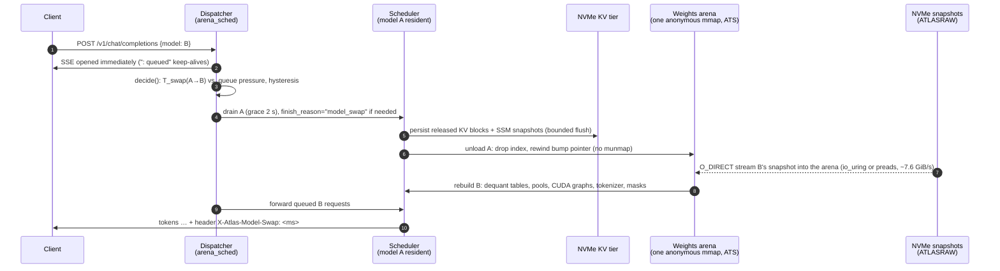
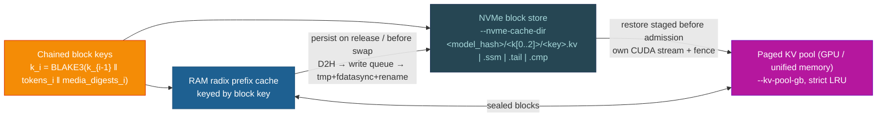

<h1 align="center">Atlas · OpenGrid edition</h1>

<p align="center">
  <strong>Many models, one DGX Spark. Sessions that outlive the RAM they ran in.</strong><br>
  <em>An open-source inference stack by OpenGrid, built on the Atlas engine, on the way to a decentralised AI grid.</em>
</p>

<p align="center">
  <a href="LICENSE"></a>
  
  
  
  <a href="https://github.com/Atlas-Inf/atlas"></a>
</p>

> **⚠️ Experimental software. For testing only.**
> This fork is a research and engineering testbed. It is not hardened, not audited, and not
> supported for production or for any workload you cannot afford to lose. Model switching,
> the NVMe KV tier and the pressure scheduler are new code paths that have been validated on
> exactly one class of machine (DGX Spark, GB10). Expect sharp edges, breaking changes and
> on-box-only verification. Run it on a box you own, behind an authenticating proxy, with
> data you are allowed to lose.

---

## Table of contents

- [What this is](#what-this-is)
- [The OpenGrid idea](#the-opengrid-idea)
- [How it works today](#how-it-works-today)
  - [Model switch: one arena, N snapshots](#model-switch)
  - [KV offload: sessions live on NVMe, not in RAM](#kv-offload)
  - [Everything else the engine already does](#everything-else)
- [Numbers](#numbers)
- [Quick start](#quick-start)
- [Roadmap](#roadmap)
- [Repository map](#repository-map)
- [Contributing](#contributing)
- [Credits](#credits)
- [License](#license)

---

<a id="what-this-is"></a>

## What this is

Atlas is a pure-Rust LLM inference engine with hand-tuned CUDA kernels for NVIDIA's GB10
(DGX Spark). Upstream Atlas answers the question *"how fast can one model run on one
Spark?"*. This fork, maintained by **OpenGrid**, asks a different one:

> **How many models and how many sessions can one Spark serve usefully, and how do several
> Sparks share that work?**

Three things make this fork different from upstream:

1. **Model switch instead of model pinning.** A single server registers a whole catalogue of
   models (chat, coding, vision, reasoning, embeddings, rerankers, translation, OCR, speech,
   image generation). Exactly one large model is resident at a time. A request for a
   different model triggers an unload → snapshot load → rebuild, in seconds, without a
   process restart. The switch is measured, exposed in a response header, and fed back into
   a pressure scheduler that decides *when* switching pays off.
2. **KV offload to NVMe with unified-memory staging.** Finished or idle sessions do not hold
   RAM. Their KV blocks (and SSM state for hybrid models) are persisted to a
   content-addressed block store on NVMe and restored on revisit, across model switches and
   across server restarts. RAM becomes the hot working set; the number of live sessions is
   bounded by disk, not by the 120 GB of unified memory.
3. **A path to a grid.** The long-term goal is a federation of DGX Sparks that lend idle
   capacity to each other, with every request that leaves its home box encrypted by the
   engine. That part is a roadmap, not a feature. See [Roadmap](#roadmap).

Everything upstream Atlas does, this fork still does: OpenAI, Anthropic and Responses APIs
on one port, hybrid SSM + attention + MoE model families, NVFP4 / FP8 kernels, MTP
speculative decoding, quantised KV cache, EP=2 across two Sparks. The upstream README and
docs remain the reference for kernels and model support; this README covers what OpenGrid
adds.

<a id="the-opengrid-idea"></a>

## The OpenGrid idea

A rooftop PV system produces power whether or not the house needs it. The grid turns that
into value: at noon the surplus feeds the neighbours, at night the house draws from the
grid. Nobody sizes their roof for their worst-case consumption.

We think inference hardware should work the same way. A DGX Spark idles most of the day.
When it is busy, it is *very* busy, and a second box would help for twenty minutes. The
OpenGrid plan is:

- **Lend when idle.** A member's Spark announces free capacity to the grid.
- **Borrow under load.** When local queues exceed what the deadline-admission layer can
  promise, requests overflow to another member's box.
- **Never trust the foreign box with plaintext.** Requests that leave the home node are
  encrypted end to end by the engine; keys stay with the requester. How much of the
  *execution itself* can be shielded (GPU confidential-computing modes, attestation) is an
  open design question we have not answered yet.
- **Settle fairly.** Capacity given and taken is metered, so the grid can balance
  contributions over time.

The two mechanisms described next are the groundwork. A grid node that cannot switch models
quickly, or that loses every session when it hands work elsewhere, is not a useful grid
node. So we built those first, on a single box, and measured them.

<a id="how-it-works-today"></a>

## How it works today

<a id="model-switch"></a>

### Model switch: one arena, N snapshots



**Registry, not restart.** `serve.sh` (or the `ATLAS_PRESEED_*` environment) declares every
model the server may serve, grouped by category (`generative`, `embed`, `rerank`,
`translate`, `ocr`, `transcribe`, `image`). At boot each model gets a hash-verified
**ATLASRAW snapshot** on NVMe: the already-migrated, already-laid-out weight image, written
once from the HuggingFace safetensors. Then the server waits idle with nothing resident. The
first request names a model and pays the load. There is deliberately no warm-up and no
pre-load.

**One arena, zero-copy weights.** All weight tensors of the resident model live in a single
process-lifetime anonymous `mmap`, the **weights arena**. On GB10 the GPU reads that mapping
coherently over NVLink-C2C with Address Translation Services, so the raw host virtual
address is passed to kernels as-is: no `cudaMemcpy` of weights, no device-side copy,
optional `cudaHostRegister` for a measured ~2 % bandwidth gain. Unloading a model is a bump
pointer rewind plus a page release. Loading the next one streams its snapshot straight into
the same arena with O_DIRECT, through io_uring where the kernel allows it and sequential
preads otherwise (the measured 7.2–7.7 GiB/s below are from the pread fallback, io_uring
being blocked in that container). Pointer stability means `spark-model` never learned that
models come and go.

**Measured, not guessed.** Every real swap updates an EWMA of `T_load`, `T_warmup`,
`T_unload` and `T_persist` per model, persisted to `snapshots/swap_costs.json`. The
dispatcher's pure decision function (`decide(now, stats, costs, cfg) → Stay | Swap`) uses
those costs, the per-model arrival rate and a residency hysteresis to avoid thrashing when
two models are requested alternately. Requests for a non-resident model queue (HTTP 429 past
`--max-queue-length`); streaming clients get their SSE connection immediately with
keep-alive comments while they wait; non-streaming clients get an estimate and a hard wait
bound. The triggering request carries `X-Atlas-Model-Swap: <ms>`.

**Sidecars for what should not swap.** Whisper and Qwen-Image are small or shaped
differently enough to stay resident on their own CUDA stream next to the arena model. Small
embedding and reranker models (≤ `--sidecar-small-max-gib`) can run the same way.

Where to read more: [`docs/hotswap/task6-decisions.md`](docs/hotswap/task6-decisions.md)
(why synchronous swap, what dual residency would buy),
[`docs/hotswap/trace.md`](docs/hotswap/trace.md) (the load-path trace that made the arena
possible), [`HOTSWAP_MVP_PLAN.md`](HOTSWAP_MVP_PLAN.md),
[`TASK6_MULTIMODEL_PLAN.md`](TASK6_MULTIMODEL_PLAN.md),
[`crates/spark-server/src/arena_sched/`](crates/spark-server/src/arena_sched/),
[`crates/spark-server/src/swap_costs.rs`](crates/spark-server/src/swap_costs.rs),
[`crates/spark-runtime/src/weights_arena.rs`](crates/spark-runtime/src/weights_arena.rs).

<a id="kv-offload"></a>

### KV offload: sessions live on NVMe, not in RAM



**One identity for RAM and disk.** Every 16-token KV block is addressed by a 128-bit chained
BLAKE3 key over the token prefix, the media digests of any images in that prefix, the model
hash and the KV layout hash. The RAM radix cache and the NVMe store use the *same* key, so
a prefix match in one is a prefix match in the other, and vision prompts became cacheable
for the first time (same text, different image ⇒ different chain).

**Persist on release.** When a sequence finishes, or when the model is about to be unloaded
for a switch, its sealed blocks are copied device-to-host and handed to a background writer:
O_DIRECT where the filesystem allows it, 4-KiB headers binding each record to model and
layout, xxh3 checksums, atomic tmp + `fdatasync` + `rename`. A record with an existing key
is never written twice. For hybrid SSM models (Qwen3-Next, Qwen3.5/3.6/3.8 GDN layers,
Nemotron Mamba-2) every block-aligned **Marconi SSM snapshot** is persisted alongside, so a
restore has a resume point instead of recomputing the recurrent state from token zero.

**Restore before admission.** On a revisit the dispatcher stages the longest contiguous
persisted prefix into host buffers *before* the request reaches the scheduler, then uploads
it on a dedicated CUDA stream with a GPU-side fence. On GB10 those host buffers are the same
physical LPDDR5X the GPU addresses, so the "upload" is a coherent copy inside unified memory
rather than a PCIe transfer: scheduler-thread cost per restored ~2.8k-token session dropped
from 1.2 s to 35 ms when it was moved off the default stream. Prefixes shorter than
`--nvme-restore-min-tokens` are recomputed instead.

**What RAM is for, then.** The KV pool holds what is being decoded right now plus whatever
LRU cache fits. Under pressure the pool evicts strict-LRU (an unpersisted block is only cache;
its persist job holds a copy) and falls back to the older disk spill for *live* sequences.
The number of sessions that can be resumed is bounded by `--nvme-min-free-pct` of the NVMe
and the `--session-ttl-hours` garbage collector, not by memory. There is a daily write
budget (`--nvme-write-budget-tb-day`) because NVMe endurance is the real resource being
spent.

**Survives restarts and switches.** The store index is loaded at boot, so sessions persisted
yesterday restore today; records are bound to the model hash, so a switch to a different
model and back finds its own blocks. Context compaction summaries (`.cmp`) live in the same
store and are recognised after a restart.

Where to read more: [`docs/design/nvme-tier-analysis.md`](docs/design/nvme-tier-analysis.md),
[`docs/design/context-compaction.md`](docs/design/context-compaction.md),
[`docs/design/test-scenarios.md`](docs/design/test-scenarios.md),
[`docs/adr/0008-nvme-high-speed-swap.md`](docs/adr/0008-nvme-high-speed-swap.md) (the older
block-streaming path for single very long contexts),
[`crates/spark-storage/src/block_store/`](crates/spark-storage/src/block_store/),
[`crates/spark-server/src/kv_tier.rs`](crates/spark-server/src/kv_tier.rs),
[`crates/spark-runtime/src/block_keys.rs`](crates/spark-runtime/src/block_keys.rs).

<a id="everything-else"></a>

### Everything else the engine already does

| Area | What you get | Where |
|---|---|---|
| APIs | OpenAI chat/completions/responses/conversations, Anthropic Messages, embeddings, rerank (Jina/Cohere shape), `/v1/translate`, `/v1/ocr` + Datalab-compatible async `/convert`, Whisper transcription, image generation and edits | [`docs/MODELS_AND_ENDPOINTS.md`](docs/MODELS_AND_ENDPOINTS.md) |
| Admission | `accepted_processing_time`: the server estimates the job and answers `503 capacity_exceeded` up front instead of timing out downstream; `X-Atlas-Estimated-Seconds` on every answer | [`docs/design/deadline-admission.md`](docs/design/deadline-admission.md) |
| Long chats | Context compaction instead of `context_length_exceeded`: the oldest turns are summarised, the summary is cached in the NVMe store | [`docs/design/context-compaction.md`](docs/design/context-compaction.md) |
| Observability | `/health`, `/metrics` (Prometheus), `/v1/stats`, `/internal/state`, `/admin/models`, `POST /v1/atlas/session/state` (is this session's prefix in RAM, on NVMe, or gone?), SQLite event DB, ntfy push alerts | [`Settings.md`](Settings.md) |
| Models | Qwen3 / 3.5 / 3.6 / 3.8 / Next / VL / Coder, Nemotron-3, Mistral-Small-4, Gemma-4, MiniMax-M2.7, Holo, Ornith, DeepSeek-V4-Flash, Step3p7, TranslateGemma, Chandra-OCR-2, Whisper, Qwen-Image-2.1 | [`docs/GB10_DEPLOYMENT_GUIDE.md`](docs/GB10_DEPLOYMENT_GUIDE.md) §2, [`kernels/gb10/`](kernels/gb10/) |
| Kernels | Per `(hardware × model × quant)` PTX bundles, NVFP4 / FP8 / BF16 paths, quantised KV cache (`bf16`, `fp8`, `turbo8`, `nvfp4`, `turbo4`, `turbo3`), MTP and DFlash speculative decoding | [`docs/ARCHITECTURE.md`](docs/ARCHITECTURE.md), [`docs/ATLAS_KERNELS.md`](docs/ATLAS_KERNELS.md) |
| Multi-box | EP=2 expert parallelism across two Sparks over RoCE (NCCL) for models that do not fit one box | [`QUICKSTART.md`](QUICKSTART.md) §7 |

<a id="numbers"></a>

## Numbers

All numbers below were measured on **one DGX Spark (GB10, 119.7 GB unified LPDDR5X, 4 TB
NVMe)** against the running server in this repository's deployment configuration
(`serve.sh`, `--max-seq-len 16384 --max-batch-size 4 --kv-pool-gb 1 --nvme-cache-dir …`),
with snapshots on the same NVMe. `--kv-pool-gb 1` is deliberately tiny: it forces eviction
so the NVMe path is exercised on every revisit. A production pool would be tens of GB and
most revisits would hit RAM instead.

They are *client-side* numbers: what `curl` sees, including HTTP, tokenisation, queueing and
the first decode step. The harness is in the repository; re-run it and file an issue if your
box disagrees.

### Model switch time per model

Run of 2026-11-07, `tests/switch_bench.py --cycles 2 --new-sessions 2`, every registered
arena model visited in catalogue order, twice; medians over the two visits (the two runs
agreed to within a second everywhere).

| Model | Serves | Snapshot | Switch wait, first request (p50 / max) | of which scheduler wait | Swap proper |
|---|---|---:|---:|---:|---:|
| `nvidia/Qwen3-Next-80B-A3B-Thinking-NVFP4` | reasoning chat | 47.3 GiB | **9.3 s** / 9.4 s | 0 (previous model idle) | 9.3 s |
| `vincentzed-hf/Qwen3-Coder-Next-NVFP4` | coding, tools | 44.2 GiB | **25.1 s** / 25.2 s | 16.5 s | 8.6 s |
| `Qwen/Qwen3-VL-30B-A3B-Instruct-FP8` | vision chat | 30.0 GiB | **33.5 s** / 33.5 s | 23.3 s | 10.2 s |
| `nvidia/Qwen3.8-27B-NVFP4` | dense reasoning + vision | 20.4 GiB | **70.4 s** / 71.0 s | 45.6 s | 24.8 s |
| `Qwen/Qwen3-Embedding-8B` | embeddings | 14.1 GiB | **9.9 s** / 10.2 s | 6.3 s | 3.6 s |
| `Qwen/Qwen3-VL-Embedding-8B` | text + image embeddings | 15.2 GiB | **3.8 s** / 3.8 s | 0 (idle) | 3.8 s |
| `Qwen/Qwen3-Reranker-8B` | rerank | 15.3 GiB | **3.7 s** / 3.7 s | 0 (idle) | 3.7 s |
| `Qwen/Qwen3-VL-Reranker-8B` | text + image rerank | 16.3 GiB | **3.9 s** / 3.9 s | 0 (idle) | 3.9 s |
| `google/translategemma-12b-it` | translation | 22.7 GiB | **6.7 s** / 6.7 s | 0 (idle) | 6.7 s |
| `datalab-to/chandra-ocr-2` | OCR | 9.9 GiB | **5.9 s** / 5.9 s | 0 (idle) | 5.9 s |

"Scheduler wait" is read off the dispatcher's own `swap decided` log line
(`trigger="pressure" pressure_s=45.8 threshold_s=45.6` for the 27B: the lone request was
held until its waiting time reached the break-even threshold, see below); "swap proper" is
the remainder: drain, persist, unload, snapshot read, rebuild. It matches the engine's own
cost accounting in the next table to within a second or two.

How to read it: "switch wait" is what the first request for a non-resident model waited
before its first token (TTFT of a streaming chat request, or the `X-Atlas-Model-Swap`
header on the non-streaming embed/rerank/translate/OCR endpoints). It is **not** just the
load. It is the sum of:

1. **Scheduler wait.** The dispatcher only evicts the resident model A for a candidate B
   once the accumulated waiting time of B's queue exceeds the waiting time the switch would
   inflict on A's users, `κ · T_swap · (1 + active_A + queued_A + λ_A · T_swap)`, and A has
   been resident for at least `--min-residency-factor` × `T_swap`. Two exceptions: if A is
   idle the switch happens at once, and a request past `--max-wait-hard-s` wins regardless.
   The benchmark walks the catalogue with no other traffic, so a lone request after a
   *busy* model hits the break-even rule head on and waits roughly one more `T_swap`; after
   an *idle* one-shot model (embed/rerank/translate/OCR) the switch is immediate, which is
   why those rows show no scheduler wait. Under mixed real traffic this rule is what keeps
   A/B alternation from thrashing; for a lone client it looks like a slow swap. It is a
   knob: `--kappa` scales the threshold, `--min-residency-factor` the hysteresis.
2. **Drain, persist, unload.** Finish or park running sequences (2 s grace), flush their KV
   to the NVMe store (bounded by `--persist-timeout-s`), rewind the arena (~1 s for 57k
   device allocations).
3. **Snapshot read and rebuild.** The part the engine itself accounts for, below.

Non-streaming requests are refused with `503 model_wait_too_long` once the estimate exceeds
`--nonstream-max-wait-s` (default 45 s); the estimate for the 27B said 70 s and the stream
saw 72–74 s. Streaming clients get their connection immediately and wait on keep-alives.

The engine's own decomposition of those costs, as it uses them for scheduling
(`snapshots/swap_costs.json`, EWMA over all swaps this server ever did):

| Model | Snapshot | Read (`T_load`) | Rebuild (`T_warmup`) | Unload | Read bandwidth |
|---|---:|---:|---:|---:|---:|
| Qwen3-Next-80B-A3B-Thinking-NVFP4 | 47.3 GiB | 7.0 s | 1.8 s | 0.6 s | 7.0 GiB/s |
| Qwen3-Coder-Next-NVFP4 | 44.2 GiB | 5.8 s | 1.7 s | 0.1 s | 7.6 GiB/s |
| Qwen3-VL-30B-A3B-Instruct-FP8 | 30.0 GiB | 3.9 s | 5.8 s | 0.9 s | 7.6 GiB/s |
| Qwen3.8-27B-NVFP4 (dense hybrid) | 20.4 GiB | 2.7 s | 23.0 s | 0.1 s | 7.7 GiB/s |
| TranslateGemma-12B | 22.7 GiB | 3.0 s | 3.5 s | 0.1 s | 7.7 GiB/s |
| Chandra-OCR-2 | 9.9 GiB | 1.3 s | 4.6 s | 0.2 s | 7.6 GiB/s |
| Qwen3-Embedding-8B | 14.1 GiB | 1.8 s | 1.9 s | < 0.1 s | 7.6 GiB/s |
| Qwen3-Reranker-8B | 15.3 GiB | 2.0 s | 1.3 s | < 0.1 s | 7.6 GiB/s |

The read runs at the NVMe's sequential ceiling; the rebuild is where the models differ.
The MoE loaders only point at the pre-packed NVFP4 tensors in the arena (~10 ms per
layer). The dense-hybrid loader for the 27B re-derives tensors on the GPU at every load:
NVFP4 requantisation of the SSM projections, transposed copies for the prefill GEMMs,
BF16→FP8 copies, with a stream sync per layer, 250–370 ms × 64 layers ≈ 18 s. Those
derived tensors are not in its snapshot yet. Because the scheduler threshold scales with
`T_swap` squared, this one rebuild also explains most of the 27B's 45 s scheduler wait
above. The two levers that would cut the client-visible number are snapshotting the
derived tensors for dense hybrids and dual residency for the hottest pair, not a faster
disk.

### KV session reactivation

Same run. Each generative model got two fresh ~2.7k-token sessions per visit; on the second
visit, after six other models had been resident in between, the old sessions were revisited.

| Model | Cold TTFT (new session) | Warm TTFT (RAM hit) | **NVMe restore TTFT** (p50 / max) | Tokens restored | Restores / misses |
|---|---:|---:|---:|---:|---:|
| `nvidia/Qwen3-Next-80B-A3B-Thinking-NVFP4` (hybrid SSM) | 3.15 s | 0.48 s | **0.69 s** / 0.70 s | 2712 | 2 / 0 |
| `vincentzed-hf/Qwen3-Coder-Next-NVFP4` (hybrid SSM) | 3.19 s | 0.51 s | **0.57 s** / 0.69 s | 2728 | 2 / 0 |
| `Qwen/Qwen3-VL-30B-A3B-Instruct-FP8` | 2.41 s | 0.32 s | **0.64 s** / 0.69 s | 2720 | 2 / 0 |
| `nvidia/Qwen3.8-27B-NVFP4` (dense hybrid) | 3.53 s | 0.81 s | **1.09 s** / 1.12 s | 2712 | 2 / 0 |

A restored session costs roughly a fifth of a cold prefill and sits within 0.2–0.3 s of a
RAM hit, for every model family including the SSM hybrids (whose recurrent state is resumed
from a persisted Marconi snapshot rather than recomputed). All 8 revisits were served from
the NVMe tier; none fell back to recompute. The store is content-addressed, so this also
holds across runs: a previous iteration of this benchmark reused its prompt texts by
mistake and every "cold" session came back from disk at 0.4 s instead of 3.1 s.

How to read it: *cold* is a fresh ~2.7k-token prompt with nothing cached. *Warm* is the same
session one turn later, served from the RAM prefix cache. *NVMe restore* is the same session
revisited after the server has served every other model in the catalogue in between: its
blocks were persisted on release, evicted from the 1 GiB pool, and restored from disk before
the request was admitted. The restored-token count is what the server reports as
`cached_tokens`; the remainder (the latest turn) is prefilled normally.

A longer run of the same mechanism, 2026-10-11, 28 minutes, 6 sessions × 4 generative
models with embed/rerank/translate rotation between visits (`tests/nvme_session_sweep.py`,
log in `logs/nvme-sweep/20261011-223431/`): 198 chat requests, 192 cache-hit turns, 108
NVMe restores, 0 HTTP errors, 0 restore misses. The run also surfaced a KV refcount leak on
warm revisits (fixed since, commit `282c4548`) and one degenerate answer after a restore
that is still under investigation. In a separate run the 80B hybrid restored 7.7k-token
sessions with SSM resume at **0.31 s TTFT instead of 8.5 s** of recompute.

### Reproduce

```bash
# server with the KV tier and a deliberately small pool, see serve.sh for the model registry
ATLAS_MAX_SEQ_LEN=16384 \
ATLAS_SERVE_EXTRA_ARGS="--nvme-cache-dir /var/tmp/atlas-nvme --kv-pool-gb 1" ./serve.sh

# switch + reactivation benchmark (2 cycles over every registered arena model, ~10 min)
python3 tests/switch_bench.py --url http://127.0.0.1:11434 --cycles 2 --new-sessions 2
# → logs/switch-bench/<ts>/summary.md

# longer soak of the tier under churn
python3 tests/nvme_session_sweep.py --url http://127.0.0.1:11434 --duration-min 30 --sessions 6
```

<a id="quick-start"></a>

## Quick start

There is no published container image for this fork yet. Build it on a GB10 box.

**Prerequisites.** NVIDIA driver ≥ 580 (CUDA 13.0), the NVIDIA Container Toolkit, a
HuggingFace cache with the checkpoints you list, and an NVMe with room for one ATLASRAW
snapshot per model (roughly the checkpoint size each) plus the KV store.

**1. Container as a systemd service.** [`.devpod/`](.devpod/) holds a rootless Podman
Quadlet: a CUDA 13 dev image with persistent cargo and sccache volumes, and the model
registry and serve flags in [`.devpod/atlas-gb10.env`](.devpod/atlas-gb10.env). Install it
once on the host (asks for sudo; reboot afterwards so the memlock limit applies):

```bash
./.devpod/install.sh
systemctl --user start atlas-gb10
podman exec -it atlas-gb10 bash      # dev shell in the running container
```

**2. Build and serve.** The container runs [`serve.sh`](serve.sh), which builds
`spark-server` in release mode and starts the server with the registry from
`ATLAS_PRESEED_*`. When the server exits (an OOM kill, say), the host page cache is dropped
and the container restarts. To change flags, edit `.devpod/atlas-gb10.env` and restart:

```bash
systemctl --user restart atlas-gb10
journalctl --user -u atlas-gb10 -f
```

The first boot writes one snapshot per registered model (minutes per model, once). After
that the server is up with **nothing resident**; the first request loads its model.

**3. Talk to it.** OpenAI-compatible on `:11434`:

```bash
curl -s http://127.0.0.1:11434/v1/models | jq -r '.data[].id'

curl -sD - http://127.0.0.1:11434/v1/chat/completions -H 'Content-Type: application/json' -d '{
  "model": "vincentzed-hf/Qwen3-Coder-Next-NVFP4",
  "messages": [{"role": "user", "content": "Write FizzBuzz in Rust."}],
  "max_tokens": 300
}' | grep -i -e x-atlas-model-swap -e '"content"'
```

Switch by naming a different model in the next request; look for the `X-Atlas-Model-Swap`
header on the one that paid. Ask the server whether a conversation can be resumed cheaply:

```bash
curl -s http://127.0.0.1:11434/v1/atlas/session/state -H 'Content-Type: application/json' \
  -d '{"model": "vincentzed-hf/Qwen3-Coder-Next-NVFP4", "messages": [...]}' \
  | jq '{ram: .ram_cache.cached_tokens, nvme: .nvme.persisted_tokens, ssm: .nvme.ssm_resume_tokens}'
```

**Production-shaped image.** `podman build -f docker/gb10/Dockerfile -t atlas-gb10 .` builds
the multi-model binary into a runtime image; see [`Deploy.md`](Deploy.md) and
[`docker/docker-guide.md`](docker/docker-guide.md). Put an authenticating reverse proxy in
front, or run with `--require-auth`; the server binds to loopback by default and warns loudly
when you open it with `--bind 0.0.0.0` without authentication.

**Flags that matter for this fork.** `--nvme-cache-dir`, `--kv-pool-gb`,
`--session-ttl-hours`, `--nvme-write-budget-tb-day`, `--nvme-restore-min-tokens`,
`--min-residency-factor`, `--max-queue-length`, `--nonstream-max-wait-s`,
`--default-context-policy`. All of them, with defaults, in [`Settings.md`](Settings.md).

<a id="roadmap"></a>

## Roadmap

Honest status, newest first. "Done" means merged and verified on the box, nothing more.

| Area | Status | Notes |
|---|---|---|
| Model switch with measured costs, queueing, immediate SSE | done | single arena, synchronous swap, `X-Atlas-Model-Swap` |
| NVMe KV tier: persist on release, restore before admission, SSM resume, restart survival | done | content-addressed store, chained keys shared with RAM cache |
| Deadline admission (`accepted_processing_time`) and Datalab-compatible `/convert` | done | per-endpoint estimators calibrated on-box |
| Context compaction (synchronous path, `.cmp` records in the store) | done | background compaction jobs still open |
| Write-through persistence, copy-on-write for partial blocks | open | today: persist on release only |
| Dual residency (two arenas, pointer-flip switch < 100 ms for a hot pair) | open | seams exist, memory budget is the blocker on 128 GB |
| Snapshot the derived tensors of dense hybrids | open | the 27B's 23 s per-load requantisation is the worst switch cost we have, and it inflates its scheduler wait |
| **Grid: node discovery and capacity announcement** | not started | |
| **Grid: overflow routing when local admission would reject** | not started | builds on deadline admission |
| **Grid: end-to-end encryption of foreign-node requests, key custody at the requester** | not started | execution-side shielding (GPU confidential computing, attestation) to be evaluated |
| **Grid: metering and settlement of lent / borrowed capacity** | not started | |
| **Grid: session continuity across nodes (KV records travelling with the request)** | not started | the content-addressed store was designed with this in mind; nothing is implemented |

If you want to work on the grid layer, open an issue first. The single-box mechanisms are
the stable foundation; the federation protocol is wide open and we would rather design it in
public.

<a id="repository-map"></a>

## Repository map

```
crates/spark-server/      HTTP server, dispatcher (arena_sched/), KV tier glue, compaction, OCR, APIs
crates/spark-model/       model assembly: attention, SSM, MoE layers; weight loaders per family
crates/spark-runtime/     GPU backend, paged KV cache, weights arena, block keys, prefix cache
crates/spark-storage/     NVMe block store, io_uring / O_DIRECT backends, high-speed swap
crates/atlas-kernels/     build.rs that turns kernels/<hw>/<model>/<quant>/ into PTX bundles
kernels/gb10/<model>/     CUDA kernels + MODEL.toml (sampling, behaviour, kernel registration)
tests/                    on-box harnesses: switch_bench.py, nvme_session_sweep.py, single_gpu_suite.py, …
docs/design/              NVMe tier, deadline admission, context compaction, test scenarios
docs/hotswap/, docs/adr/  hot-swap decisions and trace; architecture decision records
Settings.md, Doku.md      flag reference (German); component map and operations notes (German)
```

<a id="contributing"></a>

## Contributing

Read [`AGENTS.md`](AGENTS.md) and [`CONTRIBUTING.md`](CONTRIBUTING.md) first. The short
version of what CI enforces, all runnable without a GPU:

```bash
cargo fmt --all -- --check
ATLAS_SKIP_BUILD=1 CUDARC_CUDA_VERSION=13000 cargo clippy --workspace --tests
bash scripts/check-license-headers.sh     # SPDX AGPL-3.0-only on line 1 of every source file
typos
```

Anything that touches a numeric path, the scheduler, the arena or the block store needs an
on-box run before it is called done: `tests/single_gpu_suite.py` for model correctness,
`tests/switch_bench.py` and `tests/nvme_session_sweep.py` for the two mechanisms this fork
is about. Please state in the PR which of those you ran and paste the summary.

Security issues: see [`SECURITY.md`](SECURITY.md). Do not open public issues for them.

<a id="credits"></a>

## Credits

This is a fork of **[Atlas](https://github.com/Atlas-Inf/atlas)** by Avarok Cybersecurity
and the Atlas community. The kernels, the model families, the API surface and the
plug-and-play architecture are their work; the weights arena and model switch, the NVMe KV
tier, the pressure scheduler, deadline admission, context compaction and the embedding,
rerank, translation, OCR, speech and image endpoints are OpenGrid additions on top. We keep the upstream remote and intend to send
back what is generally useful.

Ideas we stand on, with the papers in [`CITATIONS.md`](CITATIONS.md) and the upstream
README: FlashAttention-2 and -4, FlashInfer, SageAttention 3, LeanAttention, TurboQuant and
TurboQuant+ for the KV formats; Marconi for prefix caching of hybrid SSM models; the
InstantTensor loader idea for the snapshot path. If we misattributed something, open an
issue; we would rather be corrected than wrong.

<a id="license"></a>

## License

**AGPL-3.0-only.** See [`LICENSE`](LICENSE). Every source file carries an SPDX header and
CI checks it. This fork does not offer a commercial or proprietary licence; if you need one
for the upstream engine, talk to the upstream project.

Running this software for others over a network triggers the AGPL's source-disclosure
obligation. That is intentional: a grid whose nodes run secret forks is not the grid we
want.
